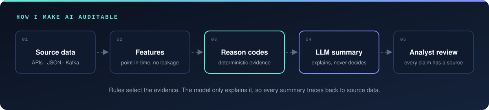

  

  <a href="https://linkedin.com/in/poturevanth"><b>LinkedIn</b></a> &nbsp;·&nbsp;
  <a href="mailto:poturevanth@gmail.com"><b>Email</b></a> &nbsp;·&nbsp;
  <a href="#aiml-engineering"><b>AI/ML</b></a> &nbsp;·&nbsp;
  <a href="#projects"><b>Projects</b></a> &nbsp;·&nbsp;
  <a href="#certifications"><b>Certifications</b></a>

I build the data underneath AI systems, and the AI systems on top of it. My pipelines stay correct under late, replayed and malformed events. My features are computed point in time, so models never train on the future. My LLM workflows put deterministic evidence first, and the model only explains it.

## Experience

### C-HIT · Centers for Medicare &amp; Medicaid Services
**Data Engineer, AI/ML** · Aug 2026 – Present · Baltimore, MD

- **Explainable GenAI.** Built an LLM workflow on Amazon Bedrock in AWS GovCloud where deterministic reason codes select the evidence and the model writes the analyst summary.
- **ML features for program integrity.** Engineered provider-level features for fraud, waste and abuse risk review, including utilization shifts, peer comparisons and enrollment signals, with point-in-time joins to prevent leakage.
- **Provider data pipelines.** Standardized NPPES and PECOS provider data with Python, PySpark and SQL, and made Kafka provider-change streams idempotent so replayed events never overwrite newer state.
- **Controls.** Added data-quality checks and source-to-target reconciliation with exception routing, shipped under HIPAA and FISMA.

### Capital One
**Data Engineer** · Mar 2024 – Jul 2026 · Plano, TX

- **ML features for credit-line models.** Engineered point-in-time features from spend, payment, delinquency and income data, so training and backfills used only what was known at each scoring date.
- **Streaming and batch.** Built Spark Structured Streaming pipelines that deduplicate Kafka card-authorization events into Delta Lake, plus batch pipelines linking reversals and refunds back to authorizations.
- **Correctness at scale.** Replaced full-history reprocessing with incremental, idempotent Delta MERGE, and traced a reconciliation mismatch to event-time partitioning.
- **Delivery.** Cut deployment time from 4 hours to 15 minutes with Terraform, Helm and Amazon EKS.

**Earlier:** Research Assistant, University at Buffalo, 2023 · Data Engineer, ServiceNow, 2022

## AI/ML engineering

  

| Capability | Where I've done it |
|---|---|
| **LLM workflows with guardrails** | Explainable GenAI on Amazon Bedrock at CMS · read-only SQL validator in [Text-to-SQL Agent](https://github.com/Revanthpotu/text-to-sql-agent) |
| **Retrieval-augmented generation** | Chunking, local embeddings, ChromaDB and source-attributed answers in [RAG Pipeline](https://github.com/Revanthpotu/rag-pipeline-langchain) |
| **Multi-agent LLM systems** | 4 GPT-4o agents running on a real-time pipeline in [HealthStream v2](https://github.com/Revanthpotu/healthstream-v2-realtime-decision-intelligence) |
| **ML feature engineering** | Point-in-time features for fraud risk at CMS and for credit-line models at Capital One |
| **ML in the warehouse** | Snowflake Cortex ML readmission-risk scores fused with live vitals in [HealthStream v2](https://github.com/Revanthpotu/healthstream-v2-realtime-decision-intelligence) |
| **Generative models** | GAN for synthetic Opioid Use Disorder records, evaluated against source patterns, at the University at Buffalo |

## Projects

| Project | What it proves | Stack | Tests |
|---|---|---|---|
| **[HealthStream v2](https://github.com/Revanthpotu/healthstream-v2-realtime-decision-intelligence)** | Streaming, ML and LLM agents in one real-time healthcare pipeline, with Avro validation, a dead-letter queue and Debezium CDC | Kafka · ksqlDB · Snowflake Cortex ML · Redis · GPT-4o | 9 |
| **[RAG Pipeline](https://github.com/Revanthpotu/rag-pipeline-langchain)** | Offline document Q&amp;A with local embeddings and source attribution | LangChain · ChromaDB · Ollama | 21 |
| **[Text-to-SQL Agent](https://github.com/Revanthpotu/text-to-sql-agent)** | Natural language to SQL, with a validator that blocks every write before it reaches the database | LangChain · SQLAlchemy · PostgreSQL | 39 |
| **[dbt + Snowflake ELT](https://github.com/Revanthpotu/dbt-snowflake-elt-pipeline)** | Raw, staging and mart layers with fact and dimension tables, on DuckDB locally and Snowflake in prod | dbt Core · Snowflake · DuckDB | 97 |
| **[Data Quality Framework](https://github.com/Revanthpotu/data-quality-framework)** | Four Great Expectations suites for completeness, validity, ranges and referential integrity | Great Expectations · pytest · Docker | 17 + 33 expectations |

<b>More projects</b>

 

| Project | What it is | Stack |
|---|---|---|
| [Kafka Real-Time Pipeline](https://github.com/Revanthpotu/kafka-realtime-pipeline) | Python producer to Kafka with validation, landing data in Amazon S3 | Kafka · Python · Docker · Amazon S3 |
| [FastAPI Banking API](https://github.com/Revanthpotu/fastapi-banking-api) | Banking REST API built with FastAPI | Python · FastAPI |

Test counts come from running each repo's own test suite. All project data is synthetic or sample data. Nothing here comes from an employer.

## Certifications

| Certification | Issuer | Issued | |
|---|---|---|---|
| **AWS Certified Data Engineer – Associate** | Amazon Web Services | Nov 2024 | [Verify ↗](https://www.credly.com/badges/1826a5b5-f261-41ef-b614-f1cd6d31eb7d) |
| **SnowPro Core Certification** | Snowflake | Mar 2025 | [Verify ↗](https://achieve.snowflake.com/356327b2-036e-49fc-a75c-dcccecb8934b) |
| **Confluent Certified Developer for Apache Kafka** | Confluent | Jul 2026 | [Verify ↗](https://certificates.confluent.io/ea628802-aa1a-4523-87a1-a144e121f671) |
| **Salesforce Certified MuleSoft Integration Foundations** | Salesforce | Jul 2026 | [Verify ↗](https://www.salesforce.com/trailblazer/mdmjedmyu6pcrufvvr) |
| **Microsoft Certified: Azure Data Engineer Associate** | Microsoft | Feb 2024 | [Verify ↗](https://learn.microsoft.com/en-us/users/lakshmipraneethrevanthkumarpotu-1951/credentials/c6c3f4b40cf7dc26) · retired by Microsoft in 2025 |

## Toolkit

| Area | Tools |
|---|---|
| **AI/ML** | Amazon Bedrock · LLMs · RAG · LangChain · ChromaDB · Snowflake Cortex ML · point-in-time feature engineering |
| **Streaming** | Apache Kafka · Confluent · Spark Structured Streaming · ksqlDB · Redis |
| **Processing** | Python · SQL · PySpark · Spark SQL · dbt |
| **Lakehouse and warehouse** | Databricks · Delta Lake · Unity Catalog · Snowflake |
| **Cloud and DevOps** | AWS · AWS GovCloud · Apache Airflow · Terraform · Docker · Kubernetes · Helm · GitHub Actions |
| **Data quality** | Great Expectations · source-to-target reconciliation · OpenAPI contract validation |

## Education

**MS Data Science** · University at Buffalo, SUNY · GPA 3.922
